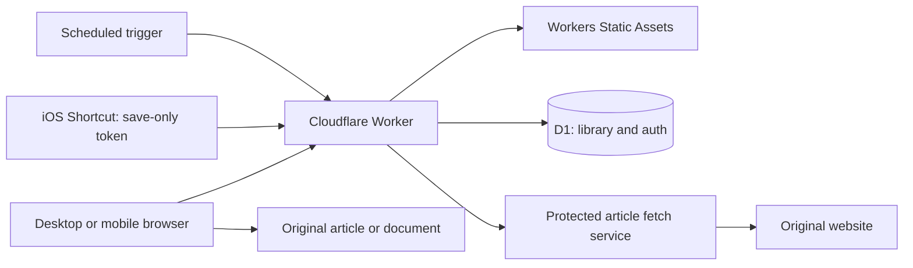

# Potem

**Potem** means “later” in Polish. It is a private, single-owner article inbox: send a URL from your desktop or phone, open the original document when ready, and explicitly mark it read. The website uses the lowercase **potem.** wordmark with two bookmarks forming a pause symbol: save your place and read later.

The service stores links, article metadata, read state, and Markdown copies captured from URLs or provided by the owner. The maintained application runs on Cloudflare Workers with D1 and Workers Static Assets; the former Node.js reader has been retired.

## Product decisions

- **One owner, multiple devices.** GitHub login allows one configured numeric user ID. There is no public registration, collaboration, or separate library per account.
- **Reading starts with the saved copy.** Click an article title or lead to read its preserved Markdown; articles without a copy open the copy editor. Open original, Mark read/unread, and Edit share the article action row. At the end of a saved article, **Mark as read** (or **Mark as unread**) saves the change and returns to the library. Reading never marks an article read automatically; read state changes explicitly.
- **The reading list comes first.** The responsive website offers Unread, Read, and All views, search, pagination, an Add dialog, article details, title editing, and deletion. Light, dark, and system themes are available.
- **Capture should stay lightweight.** Use the website, a desktop bookmarklet, an iOS Shortcut, or an installed PWA share target where supported. Native apps, browser extensions, and email ingestion are deferred.
- **Keep the stack small.** One TypeScript Worker serves the API and website; one D1 database stores the library and authentication records. Use plain HTML/CSS/browser TypeScript, prepared SQL, and migrations, without a frontend framework or ORM.
- **Use Cloudflare hosting.** Workers Static Assets and D1 serve the app; checked-in production config enables the private Container capture executor, which requires Workers Paid. Production is configured for `read.pajdzik.pl`. Actual plan and live deployment state should be checked in Cloudflare; this repository does not change billing or verify deployment.
- **Backups must be portable.** Versioned JSON exports contain library data and can be restored without copying authentication records.

## Architecture



The website and API share an origin. Wrangler routes `/api`, `/api/*`, `/auth`, `/auth/*`, and `/healthz` through the Worker before static assets. The public app shell contains no private library data; authenticated API requests populate it. Unknown API/auth routes return JSON errors instead of the HTML shell.

HTTP handlers perform authentication and validation, then call the article repository. Normalization, metadata extraction, SQL access, and authentication have small dedicated modules. There is no generic storage-provider abstraction or separate backend server.

The frontend is bundled with esbuild. JavaScript and CSS use content-hashed filenames. A minimal service worker caches selected public assets only; it does not cache article data or support offline saves. Icon URLs are versioned. Local development runs the same Worker and migrations against Wrangler's local D1.

### Saving and article metadata

Both the authenticated Add form and token capture API use the same save path. URLs must be absolute HTTP(S), have no embedded credentials, and fit within 8 KiB. The submitted URL is retained for opening the original. A separate normalized URL is the unique deduplication key: normalize host/default ports, remove fragments and `utm_*`, `fbclid`, and `gclid`, and retain other query bytes/order, path case, and trailing slashes. This deliberately treats fragment-only differences as the same article; changing the policy later requires an explicit data migration.

Saving commits the URL immediately with a supplied title or hostname/path fallback. The website Add form enables **Save a Markdown copy of the article** by default and records durable extraction intent through `captureMarkdown: true`. A scheduled Worker later claims the job and calls a private Cloudflare Container service to fetch bounded HTML and extract title/author/description and Markdown. The Worker creates the private copy in D1. Closing the browser or phone after the link-save acknowledgment does not cancel that intent. Uncheck the option for a link-only save; link-only saves do not fetch metadata.

Mobile capture tokens request background extraction by default, including existing iOS Shortcut `{url, title?}` payloads. `captureMarkdown: false` opts out. Tokens remain save-only: they cannot read copies or job history, submit Markdown, retry failed jobs, or publish to GitHub. Website details show queued, running, retrying, ready, failed, or paused status and provide an owner-only retry. Duplicate saves preserve existing copies and do not restart exhausted jobs. Reviewed browser clips take priority and continue using their existing explicit copy-save path.

The checked-in Wrangler configuration enables background processing in production and keeps it disabled for local defaults and staging. Production uses the private `ARTICLE_EXTRACTOR` Cloudflare Container service. This describes repository configuration, not a verification of the live deployment. The executor uses native Node connections pinned to validated public IPs and runs Defuddle in a bounded thread. It requires Workers Paid; see [background extraction](docs/background-markdown-extraction.md), [URL Markdown capture](docs/url-markdown-capture.md), and the [deployment guide](docs/deployment.md#background-markdown-extraction) for configuration and validation requirements.

A [deployed Defuddle Worker benchmark](docs/worker-extraction-benchmark.md) records Free-tier CPU-limit failures on larger inputs and a Paid Worker fixture trial. That trial does not validate the separately configured production Container executor or verify its live deployment; see [Cloudflare capture](docs/cloudflare-capture.md) for the current executor and remaining release checks.

A unique SQL constraint handles concurrent duplicate saves. Duplicates keep their ID, saved date, and read state. A subsequent save can fill missing author/description or replace the generated fallback title; it preserves an edited title and reports whether metadata changed.

### Database and state

| Table | Purpose |
| --- | --- |
| `articles` | ID, submitted URL, unique normalized URL, title, optional author/description, created/updated timestamps, nullable read timestamp |
| `sessions` | Hashed session tokens, CSRF tokens, expiry and creation time |
| `oauth_states` | Short-lived hashed OAuth state and browser binding |
| `capture_tokens` | Hashed save-only tokens, labels, creation and revocation dates |
| `capture_rate_buckets` | Atomic per-token, per-minute capture request counts |
| `article_copies` | Private Markdown, capture time/source, and revision |
| `article_extraction_jobs` | Durable job generation, attempts, due time, lease, and safe failure code |

There is no users table because the database represents one owner's library. Normal saves generate eight-character lowercase letter/digit IDs; imports preserve valid short IDs. Legacy UUID or opaque IDs must pass through the offline backup converter before import. Timestamps use UTC ISO strings. `read_at = NULL` means unread. Marking read twice retains the first read timestamp; marking unread clears it. Concurrent read changes use the last committed write.

Lists use descending `(created_at, id)` keyset pagination, with UTF-8-safe opaque cursors and page sizes of 1–100. Title/URL search uses parameterized substring SQL with escaped wildcard characters. Full-text indexing is deferred until the personal library needs it. Filters reset cursors, and the client ignores stale list responses.

D1 provides durable SQLite-style storage without operating a database server. A JSON file would not provide safe concurrent writes in a Worker. GitHub commits, used by the prototype, would complicate frequent saves and read-state changes. A Node/SQLite deployment remains a possible future alternative, rather than a second supported service deployment.

### Authentication and privacy

GitHub OAuth requests identity access (`read:user`) and checks the immutable numeric `OWNER_GITHUB_ID`. A short-lived, one-time state record is bound to the initiating browser. Successful login creates a 30-day session whose token is stored hashed in D1 and sent in an HttpOnly, Secure, SameSite=Lax cookie. Logout revokes it. Expired authentication records are cleaned with bounded work.

Cookie-authenticated writes require an exact same-origin `Origin` and a session-bound CSRF token. Library/auth responses use `private, no-store`; the Worker applies a restrictive content security policy and other browser security headers. Displayed content uses text nodes and validated HTTP(S) links. There is no cross-origin API allowance.

Settings creates revocable capture tokens. The plaintext is shown once; D1 stores only its hash. Tokens can save links and request server-generated background copies through `POST /api/capture`; they cannot list, read copies, export, edit, or delete articles. Capture rejects browser cookies/Origin headers and allows 60 requests per minute per token using atomic D1 counters. Ordinary JSON request bodies are limited to 16 KiB; titles to 500 characters.

An explicit local authentication bypass works only on the configured loopback origin. It must remain absent from deployed environments. Changing the owner ID requires revoking existing sessions and capture tokens because all records belong to the same library.

## Capture from desktop and mobile

| Method | Behavior |
| --- | --- |
| Website | Open Add, paste a URL and optional title, then save the link and queue an optional background Markdown copy |
| Desktop bookmarklet | Extracts the open page into an editable Markdown draft in `/add`; review and confirm in the website |
| Chrome/Firefox extension | Implementation in progress; not supported or distributed until cross-browser extension capture validation passes (E08) |
| iOS Shortcut | POSTs one URL and optional title to `/api/capture` with a save-only bearer token; background extraction defaults on |
| Installed PWA | Supported browsers open `/add` from shared URL/title/text; review and confirm |

`GET /add` never writes data. The desktop bookmarklet injects the pinned Defuddle browser bundle into the currently viewed page, extracts Markdown locally with third-party async extraction disabled, and sends it to the Potem tab through a one-use `postMessage` channel. Markdown never appears in a URL or is sent to Defuddle. Potem checks the source origin, opener, channel, source URL, and 256 KiB UTF-8 bound. The draft is editable and stays in same-origin session storage until saved. The normal Save action first saves the URL, then attempts to create a copy with `expectedRevision: null`; an existing copy is never silently replaced. If copy saving fails, the link remains saved and the draft stays available for retry or link-only saving. A changed URL cannot receive the original page’s clip. Page CSP or opener isolation can block extraction/handoff; the original URL/title prefill remains and paste remains available. Drafts survive login redirects and reloads. Shared query parameters are removed from the address bar. Ambiguous shared text does not silently choose a link. PWA share-target support varies, and native iOS/Android sharing requires actual-device validation. See the [capture guide](docs/capture.md) and website Capture help.

## API and backups

Saved articles use eight-character IDs and readable reader links such as `/read/k7m2q9x4/why-we-read`. Refresh, bookmarks, and Back/Forward restore the article; **Last opened** remembers the most recently rendered saved copy in this browser. While that article is unread, the card keeps it available to resume. Otherwise, **Picked for you** suggests a random article from the full unread library, independent of search, tabs, and pagination. **Try another** chooses a different article when alternatives exist. Suggestions stay stable during list browsing, disappear when there is nothing unread, and never change read state or the last-opened record until a saved copy is actually opened. Opening a copy leaves its read/unread state unchanged. GitHub backups use readable title-based filenames with the permanent ID inside frontmatter. See [article URLs and backup migration](docs/article-urls.md).

To retain contents from old test backups, use `pnpm backup:migrate --json /absolute/path/export.json --github-dir /absolute/path/Articles --output /absolute/path/new-directory` (either input may be omitted). It creates converted import batches, readable Markdown filenames, and an ID/path report without modifying the source or publishing to GitHub. Import the converted batches into an empty article library; UUID reader links do not carry over. New backups retain short IDs exactly through restore.

All API payloads are JSON with camelCase fields. Errors use `{error: {code, message}}`, with distinct validation, authentication, authorization, missing-resource, size-limit, rate-limit, and retryable storage errors.

| Route | Purpose |
| --- | --- |
| `GET /api/session` | Authentication state and CSRF token for the signed-in client |
| `GET /auth/github`, `GET /auth/github/callback` | Start and complete owner login |
| `POST /auth/logout` | Revoke the current session |
| `GET /api/articles` | Filter/search/page with `status`, `q`, `limit`, `cursor` |
| `POST /api/articles` | Owner save `{url, title?}`; returns the saved article and duplicate/metadata-update flags |
| `POST /api/capture` | Bearer-token save `{url, title?}`; returns only `{ok:true, extractionRequested}` with HTTP 200 for both new and duplicate saves |
| `GET /api/articles/:id` | Retrieve an article |
| `PATCH /api/articles/:id` | Change title and/or read state |
| `DELETE /api/articles/:id` | Delete an article |
| `GET /api/articles/:id/copy`, `PUT /api/articles/:id/copy` | Read or save a private Markdown copy with revision checks |
| `GET /api/articles/:id/extraction`, `POST /api/articles/:id/extraction/retry` | Owner-only capture status and retry of failed extraction |
| `GET /api/integrations` | Discover optional article destinations |
| `GET /api/articles/:id/integrations` | Check confirmed status for each integration |
| `POST /api/articles/:id/integrations/:integrationId` | Send a persisted revision to the reviewed destination |
| `POST /api/articles/:id/extraction/recapture`, `POST /api/articles/:id/extraction/undo` | Recapture an incorrect or missing copy, or restore the preceding copy with revision checks |
| `GET /api/github` | Owner-only GitHub configuration for capture before an article exists; never returns credentials |
| `POST /api/github/reconcile` | Reconnect recognized GitHub backup filenames to restored articles; owner session and CSRF required |
| `GET /api/articles/:id/github`, `POST /api/articles/:id/github` | Check the configured GitHub destination or save the persisted Markdown copy there |
| `GET /api/export`, `POST /api/import` | Download or restore versioned library JSON |
| `GET`, `POST /api/capture-tokens` | List token metadata or create a token |
| `DELETE /api/capture-tokens/:id` | Revoke a token |
| `GET /healthz` | Public liveness response; not a database readiness check |

Article details offer **Recapture article**, an optional metadata refresh, and guarded one-step undo. The existing copy stays readable while recovery runs. See [capture recovery](docs/capture-recovery.md) for behavior, concurrency, API, and migration details.

Export format is `{version: 2, exportedAt, articles: [...]}`; each article may include its Markdown copy and capture metadata. Import accepts versions 1 and 2. Exports exclude authentication records and stream articles in bounded pages. Concurrent edits can affect different pages, so avoid editing during a backup when consistent results matter.

Import accepts up to 1 MiB and 1,000 articles. It validates the complete input and uses a transactional D1 batch. New records retain IDs/dates and copies; existing normalized URLs are skipped without attaching their incoming copies; IDs already associated with different URLs are rejected. Older exports without author/description remain accepted. A full export can exceed the import bound, as before; split large restores into valid files. Import is a restore/merge operation, not an overwrite or rollback mechanism. Keep exports outside Cloudflare and test restores in a separate database.

To rehearse a downloaded backup without changing the file or contacting production, run `pnpm archive:rehearse --backup /absolute/path/export.json --report /absolute/path/report.json`. The count/byte report includes local database size, never private article content or production headroom. See the [archive rehearsal guide](docs/archive-rehearsal.md) for limits, cleanup, and the pending deployed release checks.

To convert a legacy Obsidian Markdown folder offline, run `pnpm obsidian:convert --source /absolute/path/Articles --output /absolute/path/new-output-directory`. The converter reads but never changes the source, does not start a server or contact a service, and writes a private review report plus bounded version-2 import files. Review `report.json` before using Settings → Import. See the [Obsidian migration guide](docs/obsidian-import.md) for mapping rules, limits, and fixture evidence; actual-vault migration remains an owner-reviewed step.

To recover GitHub Markdown backups offline, run `pnpm github:convert --source /absolute/path/Articles --output /absolute/path/new-output-directory`. It reads Potem backup files without contacting GitHub or changing the source, then writes a private `report.json` and bounded version-2 import files. The report flags every imported article with `read_state_not_backed_up`; GitHub Markdown does not contain read state. Review the report and batches before using Settings → Import. See the [GitHub Markdown recovery guide](docs/github-recovery.md) for accepted fields, limits, duplicate handling, and fixture evidence. Actual backup folders have not been read or imported.

## Markdown preservation

Pasting a URL in Add queues a Markdown copy by default; the reader displays it when background capture completes. Paused or failed capture keeps the link available. Article details also let the owner paste Markdown or load a UTF-8 `.md`/`.markdown` file, read the saved copy, or download it. Saving is explicit, replacements use revision checks, and each copy is limited to 256 KiB UTF-8. The editor shows capture time, source, and byte count; failed saves keep the draft. The original link and read state remain independent.

Markdown delivery is an optional integration. In article details or browser capture, choose an integration and check **Also send to an integration**, or use **Send saved copy** later. Copies stay private in Potem unless a destination is explicitly selected; failed deliveries leave local storage intact. GitHub is one provider, with the existing `GITHUB_BACKUP_*` configuration and backup history. Custom hooks can send the saved article to another service, such as a Kindle delivery adapter, through a private service binding. The browser extension can also save automatically in Potem with no external destination. See [optional integrations](docs/integrations.md) for the provider interface, hook contract, configuration, consent, and retry behavior. Production's optional GitHub destination remains public `Pajdzik/Kamilpedia`, branch `main`, under `Articles/`; see the [GitHub Markdown guide](docs/github-markdown.md) for its file format and recovery.

Copies are editable Markdown text. Article details can open the last successfully saved revision in a sanitized reader or download it as a UTF-8 Markdown file with quoted YAML frontmatter. The reader remembers a numeric position per article and saved-copy revision in local browser storage; opening it after a reload restores the position only when the user opens that article. This small metadata exception contains no article text, title, or URL; the Markdown copy remains server-side. Raw HTML is shown as text, unsafe links are unlinked, and image references are shown as text because their external sources are not included. Reading and downloading do not change read state or include unsaved editor drafts. R2 is deferred until measured storage needs justify it.

The A01 decision and browser-capture boundary are recorded in [markdown-preservation.md](docs/markdown-preservation.md). The [Worker benchmark](docs/worker-extraction-benchmark.md) includes Free-tier failures and a Paid Worker fixture trial; this does not validate the configured Container executor. The [background Markdown extraction design](docs/background-markdown-extraction.md) specifies the implemented D1 jobs for website and mobile saves, including existing iOS Shortcut payloads. Production's checked-in configuration enables processing, but live deployment, safe-fetch behavior, and runtime cost have not been independently verified here. See the release checks in [Cloudflare capture](docs/cloudflare-capture.md) and archive tasks A01–A06 in the [implementation tracker](docs/tasks.md).

## Local development

Requires Node 22.12+ and pnpm 12.4.1.

```sh
pnpm install --frozen-lockfile
cp .dev.vars.example .dev.vars
pnpm db:migrate:local
pnpm dev
```

Open http://localhost:8787. The example enables loopback-only authentication bypass. `.dev.vars`, local database files, and build artifacts are ignored. Restart `pnpm dev` after frontend edits to rebuild assets. `pnpm start` is an alias for `pnpm dev`.

```sh
pnpm check
pnpm typecheck
pnpm test
pnpm build
pnpm exec playwright install chromium webkit
pnpm test:browser
pnpm test:mobile
pnpm test:archive
pnpm test:obsidian
pnpm test:github
```

`check` aliases `typecheck`, which checks the Worker, browser app, service worker, scripts, and tests. Tests run against local Worker/D1 bindings and apply real migrations. `build` bundles website assets and dry-runs Worker deployment. Browser smoke uses temporary D1 storage and an ephemeral port to exercise persisted read state, capture drafts, errors, and desktop/mobile layouts. `test:mobile` uses a separate temporary Wrangler config, local Worker/D1, and fixture server, then exercises touch flows with Android Chromium and iPhone WebKit profiles in portrait, short portrait, and landscape. It checks manifest-driven sharing, save retries, queued/paused capture, manual-copy reading, read state, populated service-worker cache boundaries, and the local capture-token HTTP contract. Both runners emit screenshots under `/tmp`; see [mobile release validation](docs/mobile-release.md) for paths, browser versions, deployed read-only checks, and pending physical-device results. Archive rehearsal restores a representative export into a second fresh local D1 database, reconciles all fields, verifies idempotent imports, and reads/downloads restored copies with external requests blocked. Install Chromium and WebKit for the browser runners, or supply `BROWSER_EXECUTABLE` for Chromium and `WEBKIT_EXECUTABLE` for WebKit.

`test:obsidian` exercises the offline converter against temporary vaults, then imports converted fixtures through a temporary real Worker/D1 API, exports and reconciles them, repeats the import, and verifies a preexisting normalized-URL record and its copy/read state remain intact.

`test:github` exercises strict GitHub writer-format recovery and its actual-writer round trip, then imports synthetic converted files through a temporary local Worker/D1 API. It reconciles persisted records, repeats the import, and confirms a preexisting normalized-URL record retains its title, copy, and read state.

## Deployment and operations

One Worker deployment contains API code and static assets. Production is served at <https://read.pajdzik.pl> by Worker `read-it-later-production`, backed by D1 database `read-later-production`; its migrations are applied. Production sign-in is restricted to the configured GitHub owner. Set the GitHub OAuth app homepage to `https://read.pajdzik.pl` and its callback to `https://read.pajdzik.pl/auth/github/callback`.

Store `GITHUB_CLIENT_ID` and `GITHUB_CLIENT_SECRET` as **Production secrets** in Cloudflare under **Workers & Pages → read-it-later-production → Settings → Variables and Secrets**. Never put OAuth credentials in `wrangler.jsonc`, source code, or logs. Local, staging, and production data are separate; staging configuration still has placeholders.

For a manual production release, build assets, apply migrations to the production D1 database, and deploy the production Worker:

```sh
pnpm build:web
pnpm exec wrangler d1 migrations apply read-later-production --remote --env production
pnpm exec wrangler deploy --env production
```

Production CI embeds the commit SHA and the UTC time the website assets were built; that timestamp records the build, not the later deployment time. The footer opens build details with the full commit, the build time in your timezone, and a copy action. Local and manual builds with neither `BUILD_COMMIT_SHA` nor `BUILD_TIMESTAMP` are labeled as local builds; supplying incomplete or invalid metadata fails the build.

GitHub Actions runs strict TypeScript checks, Worker/D1 tests, dry-run builds, and browser smoke on pushes and PRs. A push to `main` additionally deploys the private capture service, applies production migrations, and deploys the app after verification passes. The `production` Actions environment needs `CLOUDFLARE_API_TOKEN` and `CLOUDFLARE_ACCOUNT_ID`; OAuth secrets are configured on the Worker separately. PR checks do not deploy production. See [CI](docs/ci.md) and [deployment instructions](docs/deployment.md).

Back up before destructive schema changes. Prefer additive migrations and roll back only to code compatible with the current database; deployment does not automatically reverse migrations. Monitor request errors, CPU, D1 storage, and row usage without logging private URLs, content, tokens, or OAuth codes. Free quota exhaustion must produce recoverable errors rather than silently enabling paid services. Confirm live OAuth, anonymous-access restrictions, device capture, and backup restoration on the deployed origin; local tests cannot replace those checks.

## Repository map and supporting documents

| Path | Purpose |
| --- | --- |
| `src/worker.ts` | Routing, static assets, and response security policies |
| `src/auth/` | GitHub OAuth, owner sessions, capture tokens and limiter |
| `src/articles/` | Request validation, URL normalization, metadata extraction, Markdown copies and SQL repository |
| `src/contracts.ts` | Worker bindings and shared article/copy/error types |
| `web/` | Responsive website, capture help, manifest, icons and service worker |
| `migrations/` | Ordered article/auth/metadata SQL migrations |
| `tests/` | Worker/D1 integration and regression tests |
| `scripts/` | Asset build and isolated browser smoke |
| `.github/workflows/` | Verification and production deployment |
| `wrangler.jsonc` | Worker, assets and environment bindings |

Supporting documents: [TypeScript migration](docs/typescript-migration.md), [original design](docs/design.md), [implementation tracker](docs/tasks.md), [capture](docs/capture.md), [browser extension install draft](docs/browser-extension-install.md), [mobile release validation](docs/mobile-release.md), [CI](docs/ci.md), [deployment and operations](docs/deployment.md), and [prototype retirement](docs/prototype.md). The original design/tracker preserve historical implementation scope; this README reflects the current Cloudflare application.

The former Node prototype is removed; source recovery and retained offline converters are described in [prototype retirement](docs/prototype.md).
