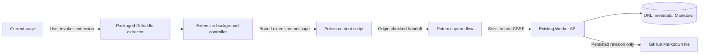

# Potem browser extension: design and implementation tasks

> **Current integration model:** The GitHub-only design below is historical. [Optional integrations](integrations.md) supersedes its destination and Simple-mode requirements: automatic private saving needs no integration; external delivery uses a discovered provider and destination-specific consent. The extension now supports GitHub and custom article hooks through the same API. Old GitHub-only preferences require setup again. Existing browser validation evidence below describes the earlier implementation unless otherwise stated.

Status: implementation is complete locally; the Chromium capture matrix and Firefox Review/private-save integration pass. The complete Firefox acceptance matrix and release checks remain pending.
Prepared: October 10, 2026.

## Goal and defaults

Build a small desktop extension for Chrome and Firefox that captures the current page, sends its extracted Markdown and metadata to Potem, and saves the persisted copy to the configured GitHub repository. Provide two modes: one-click automatic saving and review before saving.

Use the existing website for review, authentication, storage, and GitHub publishing. Extract the rendered page locally in the extension, rather than asking the server to fetch the URL again. This preserves content available in the current browser session and avoids depending on the currently paused server extraction service.

The following defaults resolve the unanswered design choices:

- **Review mode is initially selected.** Switching modes happens in extension Options.
- **Simple mode requires one-time setup consent to automatic GitHub publishing.** Subsequent toolbar clicks need no confirmation on the successful path.
- **Review happens in Potem**, with editable title, author, description, and Markdown.
- **One owner and one configured GitHub destination**, matching the existing product.
- **One Potem origin per build.** Production uses `https://read.pajdzik.pl`; development builds use a supplied loopback origin. Runtime support for arbitrary destinations is deferred.

Production currently targets the public `Pajdzik/Kamilpedia` repository, branch `main`, folder `Articles`. Setup must explain that captured content can become public, including content from pages requiring login. Confirming this setup enables future automatic writes; this design document itself makes no GitHub write.

V1 supports top-level HTTP(S) HTML documents on desktop. PDF conversion, embedded frames, screenshots, image downloads, whole-site crawling, selected-text capture, mobile extensions, offline upload queues, and store publication are outside implementation scope.

## User experience

### Setup

Installation opens a small Options page with the Potem destination, a mode selector, and **Connect to Potem**. Connect opens a foreground Potem tab for the existing owner login. The website returns only sign-in readiness and GitHub destination configuration to the extension through the bound connection request.

Selecting Simple mode displays the repository, branch, and folder and requires **Automatically save captured pages to this GitHub destination**. Persist consent with that exact destination and Potem origin. If GitHub is unconfigured, Simple mode remains unavailable; Review mode can still save privately. Changing the configured destination invalidates consent and requires setup again. Do not infer repository privacy from its name: show that content inherits repository visibility and explicitly identify the known production repository as public.

### Simple mode

1. Click the toolbar icon on a page.
2. Extract Markdown and metadata in the current tab, without changing the page or making extractor network requests.
3. Open a dedicated inactive Potem tab and hand it the capture through extension messaging.
4. The website checks login, GitHub configuration, and destination consent, then automatically saves the URL, Markdown copy, and saved copy to GitHub in that order.
5. Show a toolbar badge and tooltip: saving, saved to Potem and GitHub, or action required. Keep the result tab available with **Read in Potem**, **Open GitHub**, and **Open original** links.

If login, review, or retry is required, activate the Potem tab. Login retains the draft and resumes the authorized operation after authentication. A normal success requires one click and no editor confirmation. Keep the original source tab active on success and do not automatically close the result tab.

### Review mode

Clicking the same icon extracts the page and opens a foreground Potem capture editor. Show URL, title, author, description, Markdown text, sanitized rendered preview, UTF-8 byte count, and GitHub destination. Allow editing title, author, description, and Markdown. Keep the source URL read-only for this extension capture so edits cannot attach a clip to another page.

**Save to Potem and GitHub** performs the same ordered save as Simple mode. Also provide **Save privately in Potem** and **Cancel**. If GitHub is unavailable, disable the combined action with an explanation and retain private saving. Nothing is persisted to D1 or GitHub before an explicit save in Review mode; the browser holds the temporary draft.

## Architecture and interfaces

### Extension

Add an `extension/` directory with shared TypeScript for the background controller, extractor, website bridge, Options page, and message contracts. Use the existing esbuild tooling to produce separate Chrome and Firefox packages under ignored `dist/extension/` output.

Both builds use Manifest V3. Generate `background.service_worker` for Chrome and nonpersistent `background.scripts` for Firefox. Bundle a classic background script usable in both environments and normalize promise/message behavior through a small browser API adapter. Chrome and Firefox use different background implementations; do not rely on a background DOM or process-lifetime variables. [MDN background manifest reference](https://developer.mozilla.org/en-US/docs/Mozilla/Add-ons/WebExtensions/manifest.json/background)

Use `activeTab`, `scripting`, and `storage`, plus host permission for the single Potem origin. Source-page extraction runs only after a toolbar invocation, in the isolated content-script world, targeting the top frame. This grants temporary page access without persistent access to every website. Do not request cookies, history, GitHub hosts, `<all_urls>`, or notifications. [Chrome activeTab reference](https://developer.chrome.com/docs/extensions/develop/concepts/activeTab)

Use no action popup: `action.onClicked` directly runs the selected mode. Options provides the mode selector and connection setup. Set `incognito: "not_allowed"` in both manifests. Reuse Potem branding and provide 16/32/48/128 px extension icons.

Package the repository's pinned `defuddle/full` dependency locally. Call it with `markdown: true` and `useAsync: false`. Prefer extracted title, then document title, then the existing URL fallback. Normalize title/author/description to plain text and existing limits; resolve relative article links against the actual page URL. Do not replace that URL with a page-provided canonical URL. Do not send raw HTML, cookies, input values, arbitrary parser debug data, or page scripts.

Use Chrome 121+ and Firefox desktop 140+ as manifest minimums and verify both minimums and current stable releases. Firefox gets the stable ID `potem@pajdzik`, no Android declaration, and required data-transmission declarations for `browsingActivity` and `websiteContent`. The selected Firefox minimum supports its built-in data consent UI. [Mozilla data consent documentation](https://extensionworkshop.com/documentation/develop/firefox-builtin-data-consent/)

### Capture handoff and lifetime

Define a versioned `ExtensionCapture` containing `requestId`, `mode`, `sourceUrl`, `title`, optional `author`/`description`, `markdown`, and the consented GitHub destination when Simple mode applies. Include a capture timestamp for display; the Worker remains authoritative for persisted capture timestamps. Settings live in `storage.local`; pending captures live in `storage.session`, never sync storage. Session storage survives background restarts but clears when the browser restarts. [Chrome storage reference](https://developer.chrome.com/docs/extensions/reference/api/storage)

For each invocation, generate a cryptographically random request ID. Create a blank destination tab, store its tab ID with the request, then navigate it to `/add?extension=<requestId>`; only the opaque ID appears in the URL. A separate connection request uses `/extension-connect?request=<requestId>`. These GET navigations never write library data.

The content script runs only on the configured Potem origin. Its runtime messages are authorized using extension identity, the recorded target tab ID, top-frame identity, request ID, and current destination URL. It may retrieve only the request bound to that tab, never enumerate other captures. Source-page code must have no access to a publish command or consent settings.

For the page/content-script bridge, use namespaced, versioned `window.postMessage` messages with exact `targetOrigin`; validate `event.origin`, `event.source === window`, payload shape, and request ID. Keep messages to ready, deliver draft, acknowledge draft, connection configuration, and operation result. Do not expose a generic fetch proxy or page-callable extension API. Automatic mode is accepted only from a pending extension request; adding `mode=simple` to a URL or to the bookmarklet payload must never trigger automatic saving.

Persist the draft in website `sessionStorage` before acknowledging delivery. Remove the extension's Markdown payload after acknowledgment; retain only request correlation until the result. This allows the source tab to close and preserves drafts across website reloads and OAuth redirects. Recover the extension capture at the OAuth return location, not only at `/add`.

Limit pending requests to 10 and expire them after 30 minutes, with cleanup on extension activity and tab closure. Allow one in-flight request per source tab; repeated clicks focus its destination instead of launching another save. A handoff that is not acknowledged within 20 seconds becomes an actionable error; timers are a UI deadline, not the sole cleanup mechanism. Browser restart clears undelivered extension drafts; V1 makes no offline or browser-shutdown completion guarantee.

### Website and Worker changes

Refactor the current capture submission into a shared save operation used by the bookmarklet, Review mode, and Simple mode. Keep the bookmarklet's explicit confirmation and existing unchecked GitHub checkbox. Introduce the extension capture and connection routes in the website app, retaining the same-origin session and CSRF requests. No extension bearer token, extra OAuth application, cross-origin API allowance, or new Worker upload endpoint is required.

Make an additive change to owner-authenticated `POST /api/articles`: accept optional `author` and `description`, limited to 200 and 500 characters. Trim them, treat empty text as absent, and reject invalid types or over-limit values. Pass them into the existing repository save operation. New articles store them; duplicates only fill missing values. Keep `/api/capture` save-only payloads unchanged and reject these new fields for token capture. Existing `{url, title?, captureMarkdown?}` clients remain compatible.

Extend owner-only `PATCH /api/articles/:id` to accept author and description for explicit reviewed edits, using the same limits; `null` or blank clears a field, and omission preserves it. Retain existing title/read semantics. For a conflicting duplicate, show the saved metadata alongside the draft and require confirmation of the selected metadata and any copy replacement. Only then PATCH metadata, save the copy with the reviewed revision, and optionally publish. Checkpoint this additional stage; a later copy conflict leaves the confirmed metadata edit intact and stops publishing.

Continue using these calls in order:

| Step | Request | Required behavior |
| --- | --- | --- |
| Check destination | `GET /api/github` | Simple mode checks the current configured destination against setup consent before saving |
| Save URL/metadata | `POST /api/articles` with `captureMarkdown: false` | Reuse normalization, deduplication, and owner session |
| Save Markdown | `PUT /api/articles/:id/copy` with `source: "paste"`, `expectedRevision: null` | Create a copy without silently replacing one |
| Publish saved copy | `POST /api/articles/:id/github` with returned `expectedRevision` | Publish the persisted copy, never an editor draft |

Keep `source: "paste"` for compatibility with current copies, exports, and GitHub recovery. A new extension provenance field is deferred. Existing metadata columns and copy storage suffice; no D1 migration or export-version change is required. Keep current 8 KiB URL, 500-character title, 256 KiB UTF-8 Markdown, and bounded JSON-envelope limits. The website never queues server extraction for an extension clip.

GitHub continues writing quoted frontmatter and the saved Markdown to `Articles/<article-id>.md`, with existing revision, blob-SHA, and unrelated-file protections. Retain the GitHub token exclusively on the Worker. [Existing GitHub design](github-markdown.md)

## Save state and failure handling

Track `draft → saving link → saving copy → publishing → complete`, persisting the last confirmed article ID and copy revision in the website draft. Report Potem and GitHub outcomes separately. Reentry/reload must reconcile the persisted stage rather than replaying the entire pipeline.

| Situation | Behavior |
| --- | --- |
| Extraction fails, returns blank, or exceeds 256 KiB | Open the URL/title draft with an error; require explicit link-only saving or pasted Markdown; never publish incomplete content |
| Restricted page, browser/store page, non-HTTP(S), PDF, or incognito tab | Show an actionable unsupported-page result; do not attempt automatic saving |
| Source navigates during extraction | Discard the capture and ask to invoke again; verify the URL before and after extraction |
| Existing URL without a copy | Preserve its title/read state and create the missing copy normally |
| Existing copy matches captured Markdown and submitted metadata | Reuse its persisted revision and perform the authorized GitHub save; identical content must not create another commit |
| Existing copy or metadata differs | Activate review, show the saved/current versions, and require explicit replacement confirmation with the saved revision; no automatic GitHub write |
| URL save fails | Retain draft and allow retry; no copy or GitHub request |
| Copy save fails or conflicts | Keep the saved link and draft; stop before GitHub and offer review/retry |
| Copy response is lost | Read the persisted copy; accept its revision only if Markdown and intended metadata match; otherwise stop for review |
| GitHub fails or its response is lost | Keep the D1 copy and revision; retry only the GitHub operation, using existing identical-content reconciliation |
| Destination changes or setup consent is missing | Stop Simple mode and activate setup/review; never silently publish to a different destination |
| Login expires | Preserve the stage and draft, sign in, reconcile, then resume the originally authorized action |
| User cancels or closes the destination tab | Clear pending handoff state; explain that already confirmed writes remain saved |

Preflight Simple-mode configuration before the first write and check it again before publishing. Strengthen `POST /api/articles/:id/github` with an optional `expectedDestination` object containing repository, branch, and folder. When supplied, the Worker must compare it with its configuration before making any GitHub request and return a conflict if it differs. Existing clients omitting it retain their current behavior. Simple mode supplies it, preventing a configuration change between the browser's check and the server write from changing the consented destination.

Reuse the sanitized website reader for rendered previews, including its safe-link and image-reference behavior. Keep private data out of logs, public asset caches, URLs, and error diagnostics. No hidden retries or future background publication: retries require an action on the retained result page.

## Implementation tasks

Tasks are checked only where their acceptance evidence is complete; partial implementation and browser-specific gaps remain unchecked.

| ID | Task | Depends on |
| --- | --- | --- |
| E01 | Extension foundation and browser packages | This design |
| E02 | Local page extraction | E01 |
| E03 | Bound website handoff and connection | E01 |
| E04 | Owner metadata and destination guard API changes | This design |
| E05 | Shared capture save operation and recovery | E03, E04 |
| E06 | Review experience | E02, E05 |
| E07 | Setup, Simple mode, and result feedback | E02, E03, E05, E06 |
| E08 | Cross-browser integration and regression validation | E01–E07 |
| E09 | Installation documentation and release preparation | E08 |

- [x] **E01 — Build the shared extension foundation.** Add TypeScript types, browser adapter, manifests, local icons, Options shell, and esbuild packaging. Add `build:extension` and extension typechecking to the existing scripts; emit Chrome/Firefox folders and distributable ZIPs. Parameterize one build-time Potem origin and generate matching host permissions/content-script patterns. **Evidence:** `pnpm build:extension` and `pnpm test:extension:chromium` pass; Chromium 151.0.7922.34 loads the unpacked service worker and Options page. Firefox 157.0.1 installed the built package temporarily through Marionette and passed a native private capture, while Firefox 156.0.1 previously accepted it through `web-ext run`. Manifest/permission assertions pass. Branded Chrome toolbar invocation and the complete Firefox acceptance matrix remain pending.

- [ ] **E02 — Extract the active page locally.** Bundle pinned Defuddle, extract from a cloned top-level document to avoid page mutation, normalize the four metadata fields, resolve relative links, and enforce URL/Markdown limits. Report structured unsupported/empty/oversized/navigation errors. **Acceptance:** static, JavaScript-rendered, session-authenticated, Unicode, malformed, and strict-CSP HTML fixtures yield usable Markdown; extraction makes no additional network requests, captures no form values, and leaves source DOM and location unchanged.

- [ ] **E03 — Implement the handoff and connection protocol.** Define shared versioned message types, request/tab binding, session-backed pending state, delivery acknowledgment, cleanup, and the Potem-only bridge. Add `/extension-connect` handling and draft receipt to the website. **Evidence:** the Chromium end-to-end runner exercises simultaneous captures without lost requests and rejects a known request ID sent from the wrong tab. **Still pending:** broader forged-origin, subframe, replay/expiry, background restart, and login-resume matrix.

- [x] **E04 — Add metadata persistence and a publishing destination guard.** Extend owner article create/update contracts for author/description; add optional `expectedDestination` validation to GitHub publishing. Reuse existing bounded request parsing, repository methods, and error envelopes. **Evidence:** `pnpm test` and `pnpm typecheck` pass. Tests cover normalized metadata create, duplicate protection/read-state preservation, explicit edit/clear/omit, invalid metadata bounds/types, token metadata rejection, expected-destination conflict before any provider request, and empty-folder destination equality. Existing export/GitHub metadata round-trip coverage remains passing.

- [ ] **E05 — Share and checkpoint the save operation.** Refactor existing capture submission into explicit stages with persisted progress, duplicate comparison, copy-conflict review, and saved-revision-only GitHub retry. Recover after uncertain responses and website reloads. **Acceptance:** partial failures preserve confirmed writes and the remaining draft; retries do not rewrite a saved copy, duplicate articles, or publish a stale revision; existing bookmarklet and website flows retain their behavior.

- [ ] **E06 — Build the website review flow.** Add extension-specific editable title/author/description fields, locked source URL, Markdown text and rendered preview, byte count, destination disclosure, combined/private save actions, and cancel. Reuse website styling and rendering. **Acceptance:** opening/reloading/canceling makes no library write; editing metadata and Markdown changes the saved result; conflicts require explicit revision-checked confirmation; keyboard focus and narrow layouts remain usable.

- [ ] **E07 — Finish setup and Simple mode.** Connect Options to the bound website configuration exchange; persist mode and destination-specific consent; wire direct toolbar capture, inactive saving tabs, badges/tooltips, and foreground escalation. Disable Simple mode until setup is complete. **Acceptance:** after setup, one click saves a fresh page to both D1 and GitHub without confirmation; changed destination/login/duplicates/failures activate the appropriate result or review; disabling Simple mode immediately restores review-first behavior.

- [ ] **E08 — Validate the complete workflow in both browsers.** Add protocol/extraction tests and temporary Worker/D1 integration fixtures with mocked GitHub. Automate unpacked-extension Chromium integration; run the identical acceptance matrix in actual Firefox using temporary installation or a signed test package. Do not treat Playwright's ordinary Firefox page tests as extension validation. **Chromium evidence:** `pnpm test:extension` passes the unpacked package smoke and `scripts/extension-e2e.mjs` in Chromium 151.0.7922.34. The end-to-end runner exercises the installed controller and bridge, real Potem UI and temporary Worker/D1, mocked GitHub, Unicode extraction with an unchanged source DOM, Simple save with persisted revision/destination, identical duplicate reuse, Review edits across reload, private save, conflicting duplicate preservation and cancellation to normal Add, source closure, GitHub outage and explicit same-revision retry without a second copy write, destination-change stop, wrong-tab rejection, and two simultaneous captures without lost requests. **Firefox evidence:** a temporary package installed in Firefox 157.0.1; Marionette with system access enabled only for the disposable headless profile clicked the real Extensions-panel action on a `localhost` source page outside the Potem `127.0.0.1` host permission. Unicode extraction left the source DOM unchanged, handed off to the real Potem UI, and saved a private Review capture to temporary Worker/D1. **Still pending:** the full Firefox mode/duplicate/failure/retry matrix, automated repeatability of that Firefox flow, background restart, authenticated/JavaScript-rendered and malformed extraction fixtures, and strict-CSP-specific extraction assertions.

- [ ] **E09 — Document installation and prepare a release.** A draft local installation and release guide is in [browser-extension-install.md](browser-extension-install.md). It explains permissions, modes, public repository visibility, limitations, and signing/store steps. README and capture guidance do not claim the extension is supported until E08 passes. **Pending:** full Firefox workflow and cross-browser acceptance, fresh-profile user setup, signed Firefox output, publisher/store actions, and release checklist after E08.

## Completion criteria

Final local validation also covers Review-mode GitHub saving with the provider-confirmed result URL, opening the saved reader without changing read state, and an oversized extraction recovered by pasted Markdown. Pasted recovery requires explicit review and stays unsaved across reload until confirmation. The extension checks run in CI. Local production-origin Chrome/Firefox ZIPs have been built for `https://read.pajdzik.pl`, matching the current Worker configuration; this task has not deployed the website or published/signed an extension.

The extension is ready when the same HTML page can be saved from Chrome and Firefox in Simple mode with one toolbar click after setup, and in Review mode with metadata/Markdown edits and an explicit save. Both paths must preserve the correct content in Potem and write that persisted revision with metadata to GitHub. Report failures accurately, preserve drafts and confirmed writes, and demonstrate that existing captures, backups, authentication, and revision protections still work.

Roll out the compatible website/API changes first, then distribute the extension. Observe only operation stage, safe error code, and timing; never log captured URLs, content, or credentials. Disabling or uninstalling the extension stops new captures without changing saved articles or GitHub files. Keep incomplete real-browser or live-provider checks marked pending.
