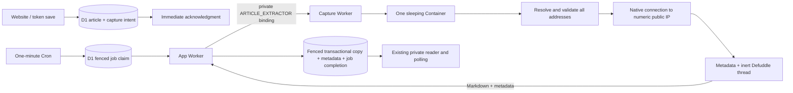

# Cloudflare Container capture

Decision, October 19, 2026: keep Workers, Static Assets, D1, and the one-minute Cron, and move the entire fetch-and-extract operation into a private Cloudflare Container. Workers Paid is accepted for this design. The implementation changes no account billing, deploys no resources, and leaves capture paused pending staging validation.

## Architecture



The app Worker keeps all D1 access, scheduling, and completion logic. The Container has no database binding, application credentials, or durable article storage. A fixed private endpoint receives only `{url}` and returns a versioned result. Source HTML stays in the executor. The capture Worker has no public workers.dev URL, preview URL, route, or custom domain. Staging and production bind to separate executors.

`ARTICLE_EXTRACTOR` replaces the previous app `ARTICLE_FETCHER` deployment contract. The internal transport named `ARTICLE_FETCHER` in `source-fetch.ts` remains an executor dependency, implemented by `capture/pinned-fetch.ts`.

Keep one eligible D1 job per tick and one Container instance per environment. A deterministic instance name avoids unnecessary instances, and a 30-second idle timeout permits sleeping. Empty cron ticks never start a Container. Overlapping work receives retryable `capture_busy`; D1 remains authoritative. Queues/Workflows add dispatch coordination without solving connection pinning and are unnecessary at this workload. Consider Queues with a D1 outbox if faster dispatch or throughput later requires it.

## Native connection boundary

`capture/pinned-fetch.ts` runs in Linux Node, not the Workers Node compatibility layer:

1. Validate HTTP(S), credentials, ports, restricted names, reserved literals, and the app's own hostname. IPv6 URL literals remain conservatively rejected; public IPv6 DNS answers are supported.
2. Native `dns.lookup({all: true, verbatim: true})` resolves terminal addresses, including aliases handled by the resolver. Reject the entire result if any returned address is private, loopback, link-local, multicast, reserved, mapped, transition, or outside allocated IPv6 global unicast. Empty answers also fail closed. `ipaddr.js` supplies special-range classification.
3. Select one validated address and pass that **numeric IP** to native HTTP(S) as the connection hostname. Disable connection pooling. Preserve the original `Host`, TLS SNI, certificate verification, and explicit `checkServerIdentity` hostname. No second hostname lookup occurs on connection; subsequent DNS changes cannot substitute a private address. Alias names are not dialed independently; their resolved addresses get the same address policy.
4. Follow each redirect manually in `source-fetch.ts` and validate/resolve/pin again. Reject loops, HTTPS downgrades, and more than three redirects. Send only fixed headers, without cookies, authorization, referer, or caller headers.
5. Request identity encoding; native Node does not transparently decompress or follow redirects. Reject an unexpected compressed response. Retain the existing five-second hop / twenty-second source deadline, counting DNS, connections, and body reads. Require complete UTF-8 HTML/XHTML at most 512 KiB by actual delivered bytes. Cancel rejected/timed-out bodies and non-pooled sockets. Truncated or oversized bodies never produce copies.

Do not substitute Workers `node:https`: Cloudflare documents that it wraps `fetch` and lacks the required TLS/socket controls. A DNS preflight followed by hostname fetch still does not pin the destination. Do not attach private-network bindings, outbound hostname interception, or proxy settings that bypass numeric socket routing. The deployed resolver and Container network path still need staging evidence; local tests are not proof of deployed enforcement.

## Conversion and protocol

The existing metadata parser and pinned Defuddle 0.19.4 / LinkeDOM 0.18.13 run inside the executor. Conversion creates a fresh inert DOM in a new Node thread, disables scripts and Defuddle async fallback, and replaces that thread's `fetch` with a throwing implementation. A five-second wall deadline can terminate synchronous parsing. Old/young generation heaps are limited to 128/16 MiB; these are V8 heap limits, not a total RSS guarantee. The Container bounds process memory as well. Empty output, conversion errors, thread exits, and excessive Markdown fail without saving partial text. Markdown remains capped at 256 KiB UTF-8.

The app calls `POST https://capture.internal/capture` **through the service binding**. This is a fixed internal request label, not a public source URL. URLs never appear in the service path/query. The request carries only the source URL, with no article IDs, user headers, or credentials.

```json
{"version":1,"ok":true,"article":{"markdown":"...","metadata":{"title":"...","author":"...","description":"..."}}}
```

```json
{"version":1,"ok":false,"error":{"code":"network_error","retryable":true}}
```

An optional `retryAfterSeconds` is validated between 1 and 3600. The app accepts only known codes/version and bounded field types, 500/200/500-character title/author/description, nonempty Markdown within the byte cap, and at most 2 MiB of response JSON (allowing escape expansion). Unknown/raw service errors become safe retryable categories. It never persists arbitrary exception text. Logs retain stable codes and job IDs, without URLs or page text.

The application service deadline is 90 seconds including cold start and response reading, less than the two-minute D1 lease. Active and late response streams are cancelled. The executor's own deadlines bound work if binding cancellation is delayed. Existing generation/lease fencing prevents a result from committing after expiry, deletion, manual-copy completion, or a newer retry generation.

## Existing contracts retained

No additional D1 migration is required beyond `0006_background_capture.sql`. Saving commits the link/intent immediately; enqueue reconciliation recovers missed jobs. One conditional claim increments attempts. Transient network, timeout, 408/429/5xx, service, and storage failures get at most three attempts with existing backoff and capped Retry-After. Permanent source/conversion failures await owner retry after cooldown. Duplicate saves do not reset attempts.

Completion inserts a copy only if absent and updates permitted metadata/job state in the existing fenced transaction. Only fallback titles can change, and author/description fill empty fields. User edits, supplied titles, read state, identity, manual/browser copies, and GitHub publishing choices retain their existing behavior. Tokens remain save-only. Imports do not restore operational jobs or fetch restored links. Background copies keep the compatible `source: "paste"` and version-2 backup format.

The Add form and token route keep their current capture defaults, status/polling, and retry/manual fallbacks. A false flag or missing binding pauses processing without preventing saves. This redesign adds no UI step or publish action.

## Cost, rollout, and evidence

Workers Paid starts at $5/month with included Container resource usage. The configured `basic` instance has 1 GiB memory, 1/4 vCPU, and 4 GB disk. One instance and short idle sleeping suit personal use; they are capacity limits, not a dollar spending cap. The [deployment guide](deployment.md#background-markdown-extraction) records an example monthly estimate, account-sharing caveats, commands, and rollout order.

Use `pnpm typecheck`, `pnpm test`, and `pnpm test:capture` without local Docker. `pnpm check:capture` additionally builds the image and requires a Docker engine; GitHub Actions runs this check on its hosted Ubuntu runner. `pnpm build` checks the base app separately. After verification, pushes to `main` build and deploy the production executor before migrating D1 and deploying the app, using the existing protected production environment and Cloudflare secrets (including Containers Edit permission). No local Docker installation or manual production executor provisioning is needed. Enable capture only after staging validation.

Local tests cover address policy, mixed public/private answers, numeric connection options plus original-host TLS checks, private/self-target rejection, the built Node extraction thread, protocol bounds/timeouts, and existing D1 races/recovery. Staging must additionally verify real TLS/redirect/rebinding behavior, network isolation, slow/truncated/oversized sources, worst-case CPU/memory under 1/4-vCPU throttling, cold starts within 90 seconds, private-only service access, and account resource use. A01/A04 release gates remain open until this evidence exists. No deployed safety or performance benchmark is claimed.

References: [Containers setup](https://developers.cloudflare.com/containers/get-started/), [Container API/lifecycle](https://developers.cloudflare.com/containers/api/container-class/), [pricing](https://developers.cloudflare.com/containers/platform/pricing/), [Workers HTTPS compatibility](https://developers.cloudflare.com/workers/runtime-apis/nodejs/https/), native [Node HTTPS](https://nodejs.org/api/https.html), and [DNS](https://nodejs.org/api/dns.html).
