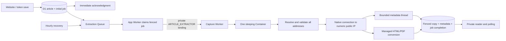

# Cloudflare Container capture

Current HTML/PDF conversion, original storage and complete archive behavior are documented in [unified ingestion](unified-ingestion.md). Server-side Defuddle architecture and manual-only/R2-deferred statements below are historical. All checked-in environments keep capture disabled pending the [fresh database reset](prelaunch-reset.md).

Decision, October 19, 2026: keep Workers, Static Assets, D1, and D1 jobs, and move the entire fetch-and-extract operation into a private Cloudflare Container. Workers Paid is accepted for this design. The checked-in configurations bind separate private executors and keep capture disabled until the fresh database cutover is verified. This configuration does not establish live deployment state. The implementation changes no account billing and deploys no resources.

## Architecture



The app Worker handles article/job writes, scheduling, and completion. The private capture Worker handles managed conversion and PDF staging using its D1/R2 bindings. The Container has no database binding, application credentials, or durable article storage. A fixed private endpoint receives a URL and optional stored-PDF identity and returns a versioned result. Source bytes stay inside the private capture service. The capture Worker has no public workers.dev URL, preview URL, route, or custom domain. Staging and production bind to separate executors.

The Container executor calls the native pinned-fetch implementation directly. The app Worker binds only to the private `ARTICLE_EXTRACTOR` service.

Queue delivery processes one job at a time per environment. A deterministic Container instance name avoids unnecessary instances, and a 30-second idle timeout permits sleeping. The hourly recovery sweep never starts a Container directly. Overlapping work receives retryable `capture_busy`; D1 remains authoritative for job state and deadlines.

## Native connection boundary

`capture/pinned-fetch.ts` runs in Linux Node, not the Workers Node compatibility layer:

1. Validate HTTP(S), credentials, ports, restricted names, reserved literals, and the app's own hostname. IPv6 URL literals remain conservatively rejected; public IPv6 DNS answers are supported.
2. Native `dns.lookup({all: true, verbatim: true})` resolves terminal addresses, including aliases handled by the resolver. Reject the entire result if any returned address is private, loopback, link-local, multicast, reserved, mapped, transition, or outside allocated IPv6 global unicast. Empty answers also fail closed. `ipaddr.js` supplies special-range classification.
3. Select one validated address and pass that **numeric IP** to native HTTP(S) as the connection hostname. Disable connection pooling. Preserve the original `Host`, TLS SNI, certificate verification, and explicit `checkServerIdentity` hostname. No second hostname lookup occurs on connection; subsequent DNS changes cannot substitute a private address. Alias names are not dialed independently; their resolved addresses get the same address policy.
4. Follow each redirect manually in `source-fetch.ts` and validate/resolve/pin again. Reject loops, HTTPS downgrades, and more than three redirects. Send only fixed headers, without cookies, authorization, referer, or caller headers.
5. Request identity encoding; native Node does not transparently decompress or follow redirects. Reject an unexpected compressed response. Retain the existing five-second hop / twenty-second source deadline, counting DNS, connections, and body reads. Require complete UTF-8 HTML/XHTML at most 2 MiB by actual delivered bytes. Cancel rejected/timed-out bodies and non-pooled sockets. Truncated or oversized bodies never produce copies.

Do not substitute Workers `node:https`: Cloudflare documents that it wraps `fetch` and lacks the required TLS/socket controls. A DNS preflight followed by hostname fetch still does not pin the destination. Do not attach private-network bindings, outbound hostname interception, or proxy settings that bypass numeric socket routing. The deployed resolver and Container network path still need staging evidence; local tests are not proof of deployed enforcement.

## Conversion and protocol

The production metadata parser runs in the executor's bounded Node thread against the fetched HTML. A five-second wall deadline can terminate synchronous parsing; V8 old/young generation heaps are limited to 128/16 MiB, which is not a total RSS guarantee. The Container bounds process memory as well. HTML and PDF conversion use the configured managed converter in the private capture Worker. Empty output, conversion errors, and excessive Markdown fail without saving partial text. Markdown remains capped at 256 KiB UTF-8. Defuddle is used by the browser capture flow, not by this Worker or executor.

The app calls `POST https://capture.internal/capture` **through the service binding**. This is a fixed internal request label, not a public source URL. URLs never appear in the service path/query. The request carries only the source URL, with no article IDs, user headers, or credentials.

```json
{"version":1,"ok":true,"article":{"markdown":"...","metadata":{"title":"...","author":"...","description":"..."}}}
```

```json
{"version":1,"ok":false,"error":{"code":"network_error","retryable":true}}
```

An optional `retryAfterSeconds` is validated between 1 and 3600. The app accepts only known codes/version and bounded field types, 500/200/500-character title/author/description, nonempty Markdown within the byte cap, and at most 2 MiB of response JSON (allowing escape expansion). Unknown/raw service errors become safe retryable categories. It never persists arbitrary exception text. Logs retain stable codes and job IDs, without URLs or page text.

The application service deadline is 90 seconds including cold start and response reading, less than the two-minute D1 lease. Active and late response streams are cancelled. The executor's own deadlines bound work if binding cancellation is delayed. Existing generation/lease fencing prevents a result from committing after expiry, deletion, manual-copy completion, or a newer retry generation.

Updated October 31, 2026: the application now uses Cloudflare Queues for immediate extraction delivery, with hourly cron for repair and republication. See [queue delivery and recovery](deployment.md#queue-delivery-and-hourly-recovery). The private Container fetch/extract boundary below is unchanged.

## Existing contracts retained

Initialize the fresh database with `0001_initial.sql`. Saving commits the article and eligible initial job together; hourly recovery republishes missed notifications and recovers expired leases. One conditional claim increments attempts. Transient network, timeout, 408/429/5xx, service, and storage failures get at most three attempts with existing backoff and capped Retry-After. Permanent source/conversion failures await owner retry after cooldown. Duplicate saves do not reset attempts.

Completion inserts a copy only if absent and updates permitted metadata/job state in the existing fenced transaction. Only fallback titles can change, and author/description fill empty fields. User edits, supplied titles, read state, identity, manual/browser copies, and GitHub publishing choices retain their existing behavior. Tokens remain save-only. Imports do not restore operational jobs or fetch restored links. Background copies keep the compatible `source: "paste"` and version-3 backup format.

The Add form and token route keep their current capture defaults, status/polling, and retry/manual fallbacks. A false flag or missing binding pauses processing without preventing saves. This redesign adds no UI step or publish action.

## Cost, rollout, and evidence

Workers Paid starts at $5/month with included Container resource usage. The configured `basic` instance has 1 GiB memory, 1/4 vCPU, and 4 GB disk. One instance and short idle sleeping suit personal use; they are capacity limits, not a dollar spending cap. The [deployment guide](deployment.md#background-markdown-extraction) records an example monthly estimate, account-sharing caveats, commands, and rollout order.

Use `pnpm typecheck`, `pnpm test`, and `pnpm test:capture` without local Docker. `pnpm check:capture` additionally builds the image and requires a Docker engine; GitHub Actions runs this check on its hosted Ubuntu runner. `pnpm build` checks the base app separately. After verification and fresh-binding preflight, pushes to `main` initialize D1, deploy the production capture service, and deploy the app, using the existing protected production environment and Cloudflare secrets (including Containers Edit permission). No local Docker installation or manual production executor provisioning is needed. Enable capture only after staging validation.

Local tests cover address policy, mixed public/private answers, numeric connection options plus original-host TLS checks, private/self-target rejection, the built Node extraction thread, protocol bounds/timeouts, and existing D1 races/recovery. Staging must additionally verify real TLS/redirect/rebinding behavior, network isolation, slow/truncated/oversized sources, worst-case CPU/memory under 1/4-vCPU throttling, cold starts within 90 seconds, private-only service access, and account resource use. A01/A04 release gates remain open until this evidence exists. No deployed safety or performance benchmark is claimed.

References: [Containers setup](https://developers.cloudflare.com/containers/get-started/), [Container API/lifecycle](https://developers.cloudflare.com/containers/api/container-class/), [pricing](https://developers.cloudflare.com/containers/platform/pricing/), [Workers HTTPS compatibility](https://developers.cloudflare.com/workers/runtime-apis/nodejs/https/), native [Node HTTPS](https://nodejs.org/api/https.html), and [DNS](https://nodejs.org/api/dns.html).
